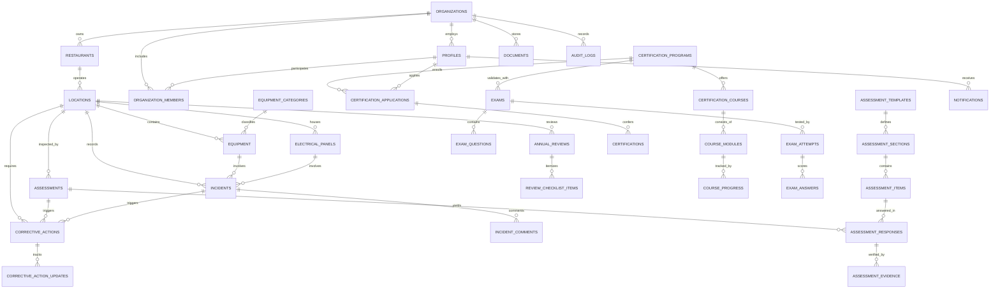

# Database Entity Relationship Diagram (ERD) & Data Dictionary
## Restaurant Electrical Authority (REA)

---

## 1. Mermaid Entity-Relationship Diagram

---

## 2. Core Entities & Field Specifications

### 1. `organizations`
- `id` (UUID, PK): Unique organization identifier.
- `name` (VARCHAR 255): Legal organization name.
- `business_registration_no` (VARCHAR 100): State/corporate registration ID.
- `email`, `phone`, `address`, `city`, `state`, `country`, `postal_code`: Corporate contact and geographic profile.
- `status` (VARCHAR 50): `active`, `inactive`, `suspended`.
- `created_at`, `updated_at`: ISO timestamps.

### 2. `profiles`
- `id` (UUID, PK): Matches Supabase auth user ID.
- `organization_id` (UUID, FK -> organizations.id): Associated organization.
- `full_name` (VARCHAR 255): User name.
- `email` (VARCHAR 255, UNIQUE): Login email.
- `role` (VARCHAR 50): `super_admin`, `admin`, `restaurant_operator`, `restaurant_manager`, `electrical_assessor`, `certification_manager`, `viewer`.
- `status` (VARCHAR 50): `active`, `inactive`, `suspended`.

### 3. `restaurants` & `locations`
- `restaurants`: Grouping of culinary brands within an organization.
- `locations`: Specific street-address facilities where equipment, panels, and electrical assessments exist.
- `locations.readiness_status`: Current calculated readiness: `compliant` (>=85%), `needs_attention` (70-84%), `non_compliant` (<70%), `pending_review`.
- `locations.readiness_score`: Aggregated score 0.00 to 100.00%.

### 4. `electrical_panels` & `equipment`
- `electrical_panels`: Core electrical distribution units (MDP, Subpanels, Disconnects), tracking amperage, voltage (120/208V 3-phase, 480V), phase, inspection dates.
- `equipment`: Electrical kitchen appliances (combi ovens, fryers, walk-in compressors, mixers, booster heaters), serial numbers, condition rating (`excellent`, `good`, `fair`, `poor`, `critical`).

### 5. `assessments`, `responses` & `evidence`
- `assessments`: Structured electrical site audits mapped to assessment templates.
- `assessment_responses`: Line-item audit verdicts: `pass`, `fail`, `needs_attention`, `not_applicable`, severity, and comments.
- `assessment_evidence`: Photo uploads and documentation linked to individual items.

### 6. `incidents` & `corrective_actions`
- `incidents`: Emergency or routine electrical events (breaker trips, overheating, shock hazard, equipment failure).
- `corrective_actions`: Actionable remedial tasks with assignees, due dates, verification workflow (`open`, `in_progress`, `submitted_for_verification`, `approved`, `closed`).

### 7. `annual_reviews`
- High-level compliance audits performed once per calendar year per location to maintain authorized status.

### 8. `certifications`, `courses`, & `exams`
- Manager certification engine featuring structured modules, progress tracking, time-limited randomized examinations with instant automatic grading, and verifiable QR-coded digital credentials.
